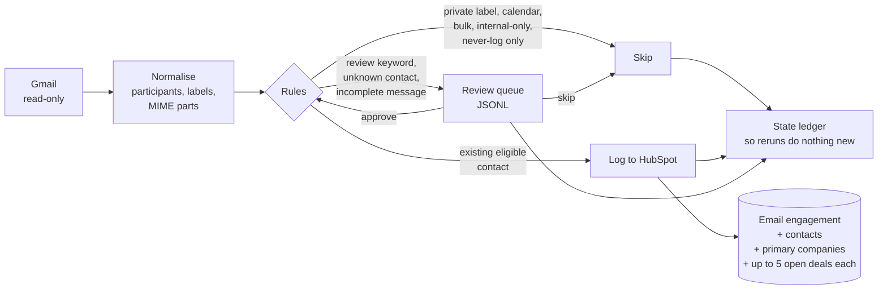

# crm-mail-sync

**Log the right emails to HubSpot, and only the right ones.**

HubSpot's "log all emails" setting has two controls: log for existing contacts only, and a Never Log list of addresses or domains. That is too coarse for a common case. Your lead investor is also the person who introduces you to half your partners.

- **Leave the investor unblocked** and every fundraising and board thread appears on their record, visible to everyone with CRM access.
- **Block the investor** and the intro threads stop reaching the *partner's* record too, because HubSpot skips the whole message.

crm-mail-sync fixes that. Keep sensitive people on HubSpot's own Never Log list and let this tool log emails selectively. A business email goes onto the record of every external customer or partner on the thread, even when a never-log person is on it too. Internal, investor-only, private and robot mail is skipped. Anything ambiguous goes to a review queue for a human to decide. It never guesses.

It is a plain Python CLI you run on a schedule. No LLM, no server, no database.



## What a run looks like

The repository ships a sample mailbox and a fake CRM, so you can see every rule fire without credentials:

```bash
crm-mail-sync run --config examples/config.example.yaml \
  --source fixtures/sample-mailbox.json --crm fake --dry-run
```

```text
2026-10-02T09:00:00+00:00 received log intro: existing eligible contacts contacts=partner@example.org companies=company-partner deals=d7,d6,d5,d4,d3
2026-10-02T09:01:00+00:00 sent skip investor-only: only never-log/internal participants
2026-10-02T09:02:00+00:00 sent skip internal-only: internal-only participants
2026-10-02T09:03:00+00:00 sent skip private-message: private label
2026-10-02T09:04:00+00:00 sent skip private-thread: private label
2026-10-02T09:05:00+00:00 sent skip calendar-subject: calendar robot
2026-10-02T09:06:00+00:00 sent skip calendar-part: calendar robot
2026-10-02T09:07:00+00:00 received skip bulk: automated sender
2026-10-02T09:08:00+00:00 sent review unknown-with-investor: unknown external participants with never-log participant
2026-10-02T09:09:00+00:00 sent review keyword: review keyword: term sheet
2026-10-02T09:10:00+00:00 sent skip already-logged: already in CRM (subject within 2 minutes)
2026-10-02T09:11:00+00:00 sent review unknown: no eligible CRM contacts; cannot decide
2026-10-02T09:12:00+00:00 sent review incomplete: incomplete message or participants
dry-run: 13 message(s); log=1 skip=8 review=4
```

The first line is the whole point: an intro the investor sent to you and a partner is logged against the partner, the partner's company and the partner's five most recent open deals. It is not logged against the investor.

## How it decides

Rules run in this order. The first match wins.

| # | Condition | Action |
| --- | --- | --- |
| 1 | Message or any message in its thread carries your private label | skip |
| 2 | Draft, spam or trash | skip |
| 3 | Calendar robot (`Accepted:`, `Invitation:` and similar, or a `text/calendar` part) | skip |
| 4 | Automated sender matching configured patterns or list/automation headers (when enabled) | skip |
| 5 | Received mail with no mailbox address or alias in To/Cc | skip (`mailbox owner only bcc'd`) |
| 6 | Malformed or unreadable message | review |
| 7 | Only internal participants | skip |
| 8 | Only internal and never-log participants | skip |
| 9 | Every other external participant has a learned `skip` rule and isn't a HubSpot contact | skip (`learned rule: skip ...`) |
| 10 | Subject or body matches a review keyword (`term sheet`, `salary`, ...), unless someone on it has a learned `log` rule | review |
| 11 | Someone on it has a learned `log` rule | **log**, adding them to HubSpot if they aren't there yet |
| 12 | At least one external participant is an existing HubSpot contact not on never-log | **log** |
| 13 | Unknown external people alongside a never-log person | review |
| 14 | Anything else | review |

BCC-only is inferred from the absence of a configured mailbox address in To/Cc; Gmail need not expose a Bcc header. Messages sent by a configured mailbox alias or labelled `SENT` are exempt. This skip happens before incomplete-message or keyword review, and approval cannot override it.

Never-log people never get an email on their record, and their presence never stops logging for other people on the same message. A learned `skip` drops a person the same way, without sending mixed threads to review, but never applies to someone who is already a HubSpot contact: it means "not worth adding, stop asking". To stop logging an existing contact, put them in `never_log`.

Learned rules come from your review decisions (see [Work the review queue](#4-work-the-review-queue)). A learned `log` is a standing approval, so it covers keyword holds too: keep anyone whose mail must always be seen first off the `log` list.

## Install

Python 3.11 or newer, on macOS or Linux.

```bash
git clone https://github.com/jhammant/crm-mail-sync.git
cd crm-mail-sync
python3 -m venv .venv
.venv/bin/pip install -r requirements.lock
.venv/bin/pip install --no-deps -e .
source .venv/bin/activate

python -m pytest -q        # fully offline
crm-mail-sync run --config examples/config.example.yaml \
  --source fixtures/sample-mailbox.json --crm fake --dry-run
```

`requirements.lock` pins the complete environment. Tests refuse network connections.

## Setup for a real mailbox

Copy `examples/config.example.yaml` to a private directory outside your checkout, for example `~/.config/crm-mail-sync/config.yaml`. Real addresses, tokens, state and the review queue all live there, never in the repo.

### 1. Gmail (read-only)

Enable the Gmail API in a Google Cloud project, configure the consent screen and create an OAuth client of type **Desktop app**. Download its client JSON into your private directory. The tool only ever asks for `https://www.googleapis.com/auth/gmail.readonly`. Google's [Python quickstart](https://developers.google.com/workspace/gmail/api/quickstart/python) covers the console steps.

Authorise once:

```python
import os
from pathlib import Path
from google_auth_oauthlib.flow import InstalledAppFlow

private_dir = Path.home() / '.config' / 'crm-mail-sync'
private_dir.mkdir(parents=True, exist_ok=True, mode=0o700)
flow = InstalledAppFlow.from_client_secrets_file(
    str(private_dir / 'client-credentials.json'),
    ['https://www.googleapis.com/auth/gmail.readonly'],
)
credentials = flow.run_local_server(port=0, access_type='offline', prompt='consent')
fd = os.open(private_dir / 'gmail-token.json', os.O_CREAT | os.O_TRUNC | os.O_WRONLY, 0o600)
with os.fdopen(fd, 'w') as stream:
    stream.write(credentials.to_json())
```

Point `gmail_token_path` at the resulting file. Runs refresh the access token in memory and never rewrite the token file or open a browser. If your consent screen is in testing mode, Google expires refresh tokens after seven days; publish the app (internal is fine for Workspace) for unattended use.

### 2. HubSpot

Create a private app (or service key) token with these scopes:

- `crm.objects.contacts.read`
- `crm.objects.contacts.write`
- `crm.objects.companies.read`
- `crm.objects.deals.read`
- `sales-email-read`

Put the token in the environment variable named by `hubspot_token_env` (default `HUBSPOT_TOKEN`). Never put it in YAML or on the command line.

Emails are created with REST v3 and explicit associations: contact `198`, company `186`, deal `210`, all `HUBSPOT_DEFINED` (see HubSpot's [association type table](https://developers.hubspot.com/docs/api-reference/latest/crm/associations/associate-records/guide#email-to-object)). Before your first real run, confirm the deal type in your portal:

```bash
curl -s -H "Authorization: Bearer $HUBSPOT_TOKEN" \
  https://api.hubapi.com/crm/v4/associations/emails/deals/labels
```

If it differs, change `EMAIL_TO_DEAL` in `src/crm_mail_sync/adapters/hubspot.py`.

### 3. Dry-run, then run

```bash
crm-mail-sync run --config ~/.config/crm-mail-sync/config.yaml --since 2026-10-01 --dry-run
crm-mail-sync run --config ~/.config/crm-mail-sync/config.yaml
```

A live dry-run reads Gmail and searches HubSpot but writes nothing: no CRM records, state, queue, lock or token files.

### 4. Work the review queue

The queue groups by who each email is with: one row per company domain, or per person on a personal address such as gmail.com. One decision clears the whole group and is remembered, so mail from them never comes back to you.

```bash
C=~/.config/crm-mail-sync/config.yaml
crm-mail-sync groups  --config $C                   # pending emails, one line per company or person
crm-mail-sync learn log  partner.example.org --config $C   # log their mail from now on, adding new people to HubSpot
crm-mail-sync learn skip newsletters.example.com --config $C
crm-mail-sync recheck --dry-run --config $C         # what the rules would now decide; writes nothing
crm-mail-sync recheck --config $C                   # log or skip every pending email the rules now decide
```

Every `run` also rechecks the queue, so an email waiting there is decided as soon as a learned rule, or a contact someone added to HubSpot, can decide it.

Or decide one email at a time, with `--remember` to learn from it:

```bash
crm-mail-sync review  --config $C                           # list pending items
crm-mail-sync approve MESSAGE_ID --remember --config $C     # log it, and log future mail with these people
crm-mail-sync skip    MESSAGE_ID --config $C                # skip just this one
```

Approval re-fetches the live message and re-applies every privacy rule, so a private label added after queueing still wins, and never-log people are never added or linked. Approving an email with people who aren't in HubSpot yet creates them as contacts, linked to the company whose domain matches theirs when exactly one does.

Decisions live in `learned.yaml` next to your config (see `learned_rules_path`). It's plain YAML: read it, delete an entry to start being asked again, or move it between lists.

```yaml
log:
  - match: partner.example.org   # a domain covers its subdomains
    added: '2026-10-15'
skip:
  - match: pat@example.com       # an address; on a personal domain such as gmail.com, always an address
    added: '2026-10-15'
```

An address beats a domain, and for the same entry `skip` beats `log`. `crm-mail-sync groups --json` and `status --json` print the queue for dashboards and other integrations; both read only and write nothing.

### 5. Optional: the review queue in your menu bar

[Roost](https://github.com/jhammant/roost) can show the queue in the macOS menu bar: a badge with the number of emails waiting, one row per company or person with *Log all and remember…* (with a confirmation) and *Skip all and remember*, and the emails one by one underneath with *Open in Gmail*, *Log just this one…* and *Skip just this one*. The plugin ships in [`integrations/roost/`](integrations/roost/):

```bash
ln -s "$PWD/.venv/bin/crm-mail-sync" ~/.local/bin/crm-mail-sync   # Roost needs it on the PATH
Roost --install-plugin integrations/roost
```

It reads `~/.config/crm-mail-sync/config.yaml` and, for approvals and syncs, the `HUBSPOT_TOKEN` in `~/.config/crm-mail-sync/env` (the same file as the cron example below). Change either path in `integrations/roost/plugin.json`.

## Configuration

All keys are top level. Unknown keys and malformed values fail before anything runs. Relative paths resolve against the config file's directory.

| Key | Meaning |
| --- | --- |
| `mailbox_addresses` | Your mailbox address and sending aliases. Used for internal membership, sent direction and detecting BCC-only received mail. Include every receiving alias to avoid skipping mail addressed to an alias. |
| `internal_domains` | Your company's domains. Subdomains match too. |
| `never_log` | Exact addresses or domains (subdomains included) that never get an email on their record. May be empty. |
| `skip_automated_senders` | Default `true`: skip automated addresses and list/automation headers with reason `automated sender`. Set `false` to disable both checks. Headers: `List-Id`, `List-Unsubscribe`, `Precedence: bulk/list/junk`, or `Auto-Submitted` other than `no` (case-insensitive). |
| `automated_sender_patterns` | Case-insensitive shell globs matched against the entire sender address (`*`, `?`, `[abc]`). Replaces the default list shown in the example config: no-reply variants, notifications, mailer-daemon, drive-shares, and docusign/echosign-style local parts or domains. For example, `['alerts@example.com', 'robot-*@example.com']`. `[]` disables address matching but preserves header checks. |
| `private_label` | Exact Gmail label name. On any message in a thread, it is a hard skip for the whole thread. |
| `review_keywords` | Case-insensitive words or phrases that send a message to review. Matched on word boundaries, so `board` does not match `onboarding`. Quoted replies are matched too, so avoid words found in email disclaimers such as `confidential` or `privileged`: on a real mailbox they sent every reply to a disclaimer-carrying sender to review. May be empty. |
| `state_path` | JSON outcome ledger and run cursor. A neighbouring `.lock` file serialises writers. |
| `review_path` | Append-only JSONL review queue, holding message snapshots and resolutions. |
| `gmail_token_path` | Authorised-user OAuth token JSON. |
| `hubspot_token_env` | Name of the environment variable holding the HubSpot token. Default `HUBSPOT_TOKEN`. |
| `hubspot_owner_id` | Optional numeric HubSpot owner ID for logged emails, or `null`. |
| `initial_since` | First-run start date, `YYYY-MM-DD` (UTC midnight). |
| `learned_rules_path` | Learned `log`/`skip` rules from your review decisions. Default `learned.yaml` next to the config; created on the first decision. |
| `personal_email_domains` | Domains where decisions are remembered per address, never for the whole domain. Replaces the default list (gmail.com, outlook.com, icloud.com and other common personal domains). |

## Scheduling

Twice a day is plenty. Cron does not inherit your shell, so keep the token in a `0600` env file containing `export HUBSPOT_TOKEN=...` and source it, with absolute paths throughout:

```cron
0 8,17 * * * . $HOME/.config/crm-mail-sync/env && $HOME/crm-mail-sync/.venv/bin/crm-mail-sync run --config $HOME/.config/crm-mail-sync/config.yaml >> $HOME/.config/crm-mail-sync/sync.log 2>&1
```

The exit status is non-zero on configuration, API or persistence failures, so alert on it. A per-state-file lock prevents overlapping runs. Use one config, state and queue per mailbox.

## Privacy: what this does and does not protect

- **Never-log controls association, not redaction.** A logged email still contains everything in it, including a never-log person's name, address and quoted text. If a thread must not reach the CRM at all, give it your private label.
- **Keyword matching is literal.** It cannot understand intent. Treat it as a tripwire, not a guarantee.
- **Attachments are never uploaded.** Calendar parts are detected recursively and skipped.
- **The review queue holds full message snapshots.** New state and queue files are created `0600` in `0700` directories. Protect backups and scheduler logs too, and set your own retention policy: approving or skipping does not erase a snapshot.
- **Rules are not retroactive.** Changing a rule does not replay old messages or remove emails already in HubSpot.

## Design notes

- `rules.py` is pure functions over normalised dataclasses. Mail, CRM and review queue sit behind small structural interfaces (`MailSource`, `Crm`, `ReviewSink`), so adding Outlook, another CRM or a Slack review queue means implementing a few methods.
- Each run checkpoints its start time and re-reads 24 hours of overlap to catch late-indexed mail. Recorded message IDs make overlap harmless. `--since` widens the fetch window; it never replays recorded outcomes.
- Each message is saved atomically and a failure never advances the cursor.
- Before creating an email the tool searches HubSpot for the same subject within two minutes either side, in case HubSpot already logged it. This can suppress an unrelated email with an identical subject at the same moment.
- Every Gmail read and HubSpot read or search backs off and retries on rate limits (HTTP 429, Gmail's per-minute quota) and gateway errors, honouring `Retry-After`. HubSpot requests are paced under its five-per-second search limit, which the token may share with other integrations.
- Creating an email is never retried: a timeout after HubSpot accepted it would log the email twice. HubSpot writes are not transactional either, so if a run crashes after HubSpot creates an email but before the local save, check HubSpot before rerunning.
- Open deals exclude `closedwon`, `closedlost` and any custom stage with `hs_is_closed` true, then take the five most recently modified per contact.

## Status and roadmap

v0.2 is alpha. Every rule, adapter payload and CLI path is covered by offline tests, and it has been dry-run against a real Google Workspace mailbox and HubSpot portal (88 messages: no errors, nothing written, and every email HubSpot had already logged itself was recognised and not duplicated). Still roll out dry-run first: your mail will differ.

Live testing changed three things before release: rate-limit backoff for Gmail and HubSpot reads, list and bulk headers as a skip rule, and dropping `confidential` from the suggested keywords.

v0.2 learns from review decisions: the queue groups by company, one decision covers every email with them, and future mail follows it. Approving someone who isn't in HubSpot now adds them.

Not yet built:

- Mail sources other than Gmail, CRMs other than HubSpot, review sinks other than a JSONL file.

Issues and pull requests welcome.

## Licence

[MIT](LICENSE)
